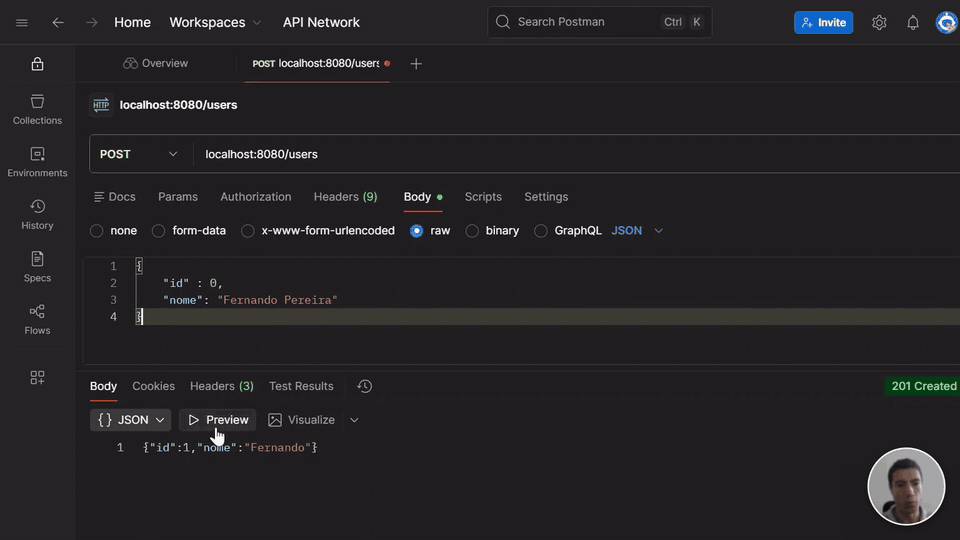

# Axum and Tokio REST API Demo

A REST API built from scratch in Rust with [Axum](https://github.com/tokio-rs/axum), [Tokio](https://tokio.rs/) and [Serde](https://serde.rs/): one `POST /users` route that receives JSON, applies a business rule and answers with the right HTTP status code.



**Full video tutorial on YouTube (28 min):** https://youtu.be/W0rsHjBSe4E

It was made for people who have never used Axum before, so the whole API fits in a single `src/main.rs`.

---

## What you'll learn

- An async `main` with `#[tokio::main]`, and a TCP listener on port 8080
- Routing with Axum's `Router` and an async handler
- JSON in and out with Serde (`Serialize` / `Deserialize`) and Axum's `Json` extractor
- Returning `201 Created` with `(StatusCode, Json<T>)`
- A simple business rule that rejects the request with `400 Bad Request`
- Reading compiler errors and fixing them (shown live in the video)

## How a request flows

```
Postman ──POST /users──▶ TcpListener (Tokio) ──▶ Router (Axum) ──▶ cria_user_handle
                                                                      │
        ◀── 201 Created + JSON  /  400 Bad Request ───────────────────┘
```

1. The client (Postman, a browser or a front end) sends a request.
2. Tokio accepts the connection on port 8080.
3. Axum's router matches `POST /users` and calls the handler.
4. The handler reads the JSON body, checks the business rule and returns the response.

## The code

```rust
async fn cria_user_handle(payload: Json<User>) -> Result<(StatusCode, Json<User>), StatusCode> {
    if payload.nome == "teste" {
        return Err(StatusCode::BAD_REQUEST);
    }

    let user = Json(User { id: 1 + 1, nome: payload.nome.to_string() });
    Ok((StatusCode::CREATED, user))
}
```

Some names are in Portuguese, as in the original recording: `nome` = name, `cria_user_handle` = create user handler, `rodando na porta` = running on port.

## Running the project

Requirements: Rust (edition 2024, so Rust 1.85 or newer).

```bash
cargo run
```

The API will be available at `http://localhost:8080`.

## Endpoint

### `POST /users`

Creates a user from a JSON body. Both fields are required.

```bash
curl -i -X POST http://localhost:8080/users \
  -H "Content-Type: application/json" \
  -d '{"id": 0, "nome": "Fernando Pereira"}'
```

| Request | Response |
|---|---|
| `{"id": 0, "nome": "Fernando Pereira"}` | `201 Created` with `{"id": 2, "nome": "Fernando Pereira"}` (the `id` simulates the one a database would generate) |
| `{"id": 0, "nome": "teste"}` | `400 Bad Request`: the business rule blocks it |
| A missing field or invalid JSON | `422 Unprocessable Entity`, rejected by Axum's `Json` extractor before the handler runs |

## Dependencies

```toml
[dependencies]
axum = "0.8.9"
serde = { version = "1.0.229", features = ["derive"] }
tokio = { version = "1.54.1", features = ["full"] }
```

Don't forget the `derive` feature on Serde: without it, `#[derive(Serialize, Deserialize)]` doesn't compile.

## Important note

This project is for educational purposes only. It does not represent a real production environment and should not be used as a production-ready API. In a real project you would use separate structs for input and output, a real database, and proper error handling.

---

Made by Fernando Santos · [YouTube tutorial](https://youtu.be/W0rsHjBSe4E) · [LinkedIn](https://www.linkedin.com/in/fernando-blockchain)
