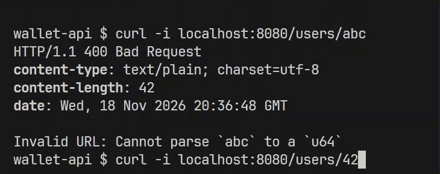

# Lesson 2: CRUD with Shared State in Axum

Lesson 1 had a single `POST /users` route. This lesson turns it into a full in-memory users CRUD. All users live in one store that every request shares across Tokio's worker threads, protected by `Arc<RwLock<...>>`. Built with Rust (edition 2024), [Axum](https://github.com/tokio-rs/axum) 0.8.9, [Tokio](https://tokio.rs/) 1.54.1 and [Serde](https://serde.rs/) 1.0.229.



**Full video tutorial on YouTube (15 min):** https://youtu.be/lFmGxQ6NGCk

---

## What it does

| Method | Route | Success | Errors |
|---|---|---|---|
| `POST` | `/users` | `201 Created` + the new user | `422` when a field is missing (rejected by the `Json` extractor) |
| `GET` | `/users` | `200 OK` + every user, sorted by id | |
| `GET` | `/users?name=ali` | `200 OK` + users whose name contains `ali` (case-insensitive) | |
| `GET` | `/users/{id}` | `200 OK` + the user | `404 Not Found`, or `400 Bad Request` when the id is not a number |
| `PUT` | `/users/{id}` | `200 OK` + the updated user | `404 Not Found`, `422` when a field is missing |
| `DELETE` | `/users/{id}` | `204 No Content` | `404 Not Found` |

The request body for `POST` and `PUT` is `{"name": "...", "email": "..."}`. The server picks the `id`.

## How it works: one list, many threads

Tokio runs handlers on several worker threads at the same time, so the users store must be shared safely:

- `Arc` gives every handler a pointer to the same `Db`.
- `RwLock` lets many readers in at once (`GET`) but only one writer at a time (`POST`, `PUT`, `DELETE`).
- `with_state` hands the state to the router, and the `State` extractor gives it to each handler.

```rust
#[derive(Default)]
struct Db {
    users: HashMap<u64, User>,
    next_id: u64,
}

type AppState = Arc<RwLock<Db>>;

let router = Router::new()
    .route("/users", post(create_user).get(list_users))
    .route("/users/{id}", get(get_user).put(update_user).delete(delete_user))
    .with_state(state);
```

The handler takes the write lock only while it changes the map. The guard is dropped at the end of the inner block, before the response is built:

```rust
async fn create_user(
    State(state): State<AppState>,
    Json(input): Json<UserInput>,
) -> (StatusCode, Json<User>) {
    let user = {
        let mut db = state.write().unwrap();
        db.next_id += 1;
        let user = User { id: db.next_id, name: input.name, email: input.email };
        db.users.insert(user.id, user.clone());
        user
    };
    (StatusCode::CREATED, Json(user))
}
```

## The two compiler errors from the video

1. **`cannot borrow data in an Arc as mutable` (E0596).** With `Arc<Db>` alone, the handler can't change the map: `Arc` only gives shared access. Wrapping it as `Arc<RwLock<Db>>` fixes it. Forgetting the lock is a compile error, not a data race in production.
2. **`the trait bound ... Handler<_, _> is not satisfied`.** `update_user` had `Json` as its first argument. `#[debug_handler]` (from the `macros` feature of Axum) turns that into a clear message: *Json consumes the request body and thus must be the last argument*. The fix is to put `State` and `Path` first and `Json` last.

## Trying it with curl

Start the server in one terminal:

```bash
cargo run
```

Then, in another terminal:

```bash
curl -i -X POST localhost:8080/users -H 'content-type: application/json' -d '{"name":"Alice","email":"alice@example.com"}'
curl -i -X POST localhost:8080/users -H 'content-type: application/json' -d '{"name":"Bob","email":"bob@example.com"}'
curl -s localhost:8080/users
curl -s 'localhost:8080/users?name=ali'
curl -i localhost:8080/users/1
curl -i localhost:8080/users/42      # 404 Not Found
curl -i localhost:8080/users/abc     # 400 Bad Request
curl -i -X PUT localhost:8080/users/1 -H 'content-type: application/json' -d '{"name":"Alice","email":"alice@wallet.dev"}'
curl -i -X DELETE localhost:8080/users/2   # 204 No Content
curl -i -X DELETE localhost:8080/users/2   # 404 Not Found
```

**Concurrency check.** Restart the server so the store is empty, then send 100 POSTs, 20 at a time, and count the unique IDs:

```bash
seq 100 | xargs -P 20 -I{} curl -s -o /dev/null -X POST localhost:8080/users -H 'content-type: application/json' -d '{"name":"user{}","email":"user{}@example.com"}'
curl -s localhost:8080/users | grep -o '"id":[0-9]*' | sort -u | wc -l
```

It prints `100`: no user lost and no duplicate id.

## Project structure

```
02-crud-shared-state/
├── Cargo.toml      # axum (with the "macros" feature), serde, tokio
├── Cargo.lock
├── docs/demo.gif
└── src/main.rs     # the whole API: models, shared state, router and the five handlers
```

## Running it

Requirements: Rust 1.85 or newer (edition 2024), plus `curl` to test.

```bash
git clone https://github.com/fernando1000/wallet-api.git
cd wallet-api/02-crud-shared-state
cargo run
```

The API listens on `http://localhost:8080`.

Dependencies:

```toml
[dependencies]
axum = { version = "0.8.9", features = ["macros"] }
serde = { version = "1.0.229", features = ["derive"] }
tokio = { version = "1.54.1", features = ["full"] }
```

## Important note

This project is for learning. The data lives in memory and is lost when the server stops. A real wallet API would use a database, input validation and proper error types.

---

Made by Fernando Santos · [YouTube tutorial](https://youtu.be/lFmGxQ6NGCk) · [LinkedIn](https://www.linkedin.com/in/fernando-blockchain)
