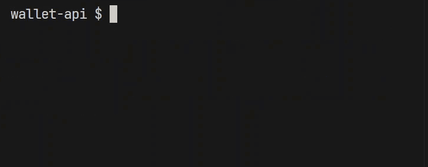

# Lesson 3: Error Handling Done Right in Axum

Lesson 2 ended with a users CRUD that returned errors in three different shapes: a `404` with an empty body, Axum's own `400` / `422` / `415` rejections as plain text, and `unwrap()` on the locks, which panics instead of answering. This lesson routes every error through one `ApiError` enum, so the client always gets the right status code and the same JSON body. Built with Rust (edition 2024), [Axum](https://github.com/tokio-rs/axum) 0.8.9, [Tokio](https://tokio.rs/) 1.54.1, [Serde](https://serde.rs/) 1.0.229 and [thiserror](https://github.com/dtolnay/thiserror) 2.0.21.



**Full video tutorial on YouTube (14 min):** https://youtu.be/gk7aUfa3HL4

---

## What it does

Same five routes as lesson 2. Every error now has the same body:

```json
{"code": "user_not_found", "message": "user 42 not found"}
```

| Status | `code` | When |
|---|---|---|
| `404 Not Found` | `user_not_found` | `GET`, `PUT` or `DELETE` on `/users/{id}` with an id that doesn't exist |
| `409 Conflict` | `email_taken` | `POST` or `PUT` with an email another user already has |
| `400 Bad Request` | `invalid_path` | the id in the path is not a number (`/users/abc`) |
| `400` / `415` / `422` | `invalid_json` | malformed JSON, missing `content-type: application/json`, or a missing field. The status comes from Axum's rejection |
| `500 Internal Server Error` | `internal_error` | a poisoned lock. The message is only `internal server error`, no internal details |

| Method | Route | Success | Errors |
|---|---|---|---|
| `POST` | `/users` | `201 Created` + the new user | `409`, `invalid_json` |
| `GET` | `/users` | `200 OK` + every user, sorted by id (`?name=ali` filters by name) | |
| `GET` | `/users/{id}` | `200 OK` + the user | `404`, `400` |
| `PUT` | `/users/{id}` | `200 OK` + the updated user | `404`, `409`, `400`, `invalid_json` |
| `DELETE` | `/users/{id}` | `204 No Content` | `404`, `400` |

## How it works: errors are values

In Rust a handler doesn't throw. It returns `Result<T, ApiError>`, and Axum turns the `Err` into a response because `ApiError` implements `IntoResponse`.

One enum lists everything that can go wrong. `thiserror` writes the `Display` message for each variant (`#[error]`) and the `From` conversions (`#[from]`):

```rust
#[derive(Debug, thiserror::Error)]
enum ApiError {
    #[error("user {0} not found")]
    UserNotFound(u64),
    #[error("email {0} is already taken")]
    EmailTaken(String),
    #[error("invalid JSON body: {0}")]
    InvalidJson(#[from] JsonRejection),
    #[error("invalid path: {0}")]
    InvalidPath(#[from] PathRejection),
    #[error("internal server error")]
    Internal,
}
```

`IntoResponse` maps each variant to a status code and a stable `code`, and builds the same JSON body for all of them:

```rust
impl IntoResponse for ApiError {
    fn into_response(self) -> Response {
        let (status, code) = match &self {
            ApiError::UserNotFound(_) => (StatusCode::NOT_FOUND, "user_not_found"),
            ApiError::EmailTaken(_) => (StatusCode::CONFLICT, "email_taken"),
            ApiError::InvalidJson(rejection) => (rejection.status(), "invalid_json"),
            ApiError::InvalidPath(rejection) => (rejection.status(), "invalid_path"),
            ApiError::Internal => (StatusCode::INTERNAL_SERVER_ERROR, "internal_error"),
        };
        let body = ErrorBody { code, message: self.to_string() };
        (status, Json(body)).into_response()
    }
}
```

The `match` has no `_` arm on purpose: add a variant and the code won't compile until it gets a status code.

### The `?` operator instead of `unwrap()`

`?` returns early with the error and calls `From::from` on it first. `RwLock::read()` fails with `PoisonError<T>`, which is generic over the guard type, so `#[from]` can't be used. The conversion is written by hand, and it drops the details on purpose:

```rust
impl<T> From<PoisonError<T>> for ApiError {
    fn from(_: PoisonError<T>) -> Self {
        ApiError::Internal
    }
}

async fn get_user(
    State(state): State<AppState>,
    AppPath(id): AppPath<u64>,
) -> Result<Json<User>, ApiError> {
    let db = state.read()?;
    db.users
        .get(&id)
        .cloned()
        .map(Json)
        .ok_or(ApiError::UserNotFound(id))
}
```

### Axum's own errors in the same format

When `Json` or `Path` can't parse the request, Axum rejects it before the handler runs, with a plain text body. Two small wrapper extractors run the original one and turn its rejection into an `ApiError` (through the `#[from]` conversions above):

```rust
#[derive(FromRequest)]
#[from_request(via(Json), rejection(ApiError))]
struct AppJson<T>(T);

#[derive(FromRequestParts)]
#[from_request(via(Path), rejection(ApiError))]
struct AppPath<T>(T);
```

The handlers use `AppJson` and `AppPath` in place of `Json` and `Path`.

## The two compiler errors from the video

1. **`` `?` couldn't convert the error to `ApiError` `` (E0277).** `state.read()?` in `get_user` before there was a `From<PoisonError<T>>` for `ApiError`. `?` needs that conversion. Adding the generic `impl<T> From<PoisonError<T>> for ApiError` fixes it.
2. **`` non-exhaustive patterns: `&ApiError::EmailTaken(_)` not covered `` (E0004).** Adding the `EmailTaken` variant broke the build until `into_response` got its `409 Conflict` arm. The compiler found the missing case, not a user in production.

## Trying it with curl

Start the server in one terminal:

```bash
cargo run
```

Then, in another terminal:

```bash
curl -i localhost:8080/users/42      # 404 user_not_found
curl -i localhost:8080/users/abc     # 400 invalid_path
curl -i -X POST localhost:8080/users -H 'content-type: application/json' -d '{"name":"Alice"}'   # 422 invalid_json
curl -i -X POST localhost:8080/users -H 'content-type: application/json' -d '{"name":"Alice","email":"alice@example.com"}'   # 201 Created
curl -i -X POST localhost:8080/users -H 'content-type: application/json' -d '{"name":"Alice","email":"alice@example.com"}'   # 409 email_taken
```

## Project structure

```
03-error-handling/
├── Cargo.toml      # axum (with the "macros" feature), serde, thiserror, tokio
├── Cargo.lock
├── docs/demo.gif
└── src/main.rs     # the whole API: models, shared state, ApiError, custom extractors, router and handlers
```

## Running it

Requirements: Rust 1.85 or newer (edition 2024), plus `curl` to test.

```bash
git clone https://github.com/fernando1000/wallet-api.git
cd wallet-api/03-error-handling
cargo run
```

The API listens on `http://localhost:8080`.

Dependencies:

```toml
[dependencies]
axum = { version = "0.8.9", features = ["macros"] }
serde = { version = "1.0.229", features = ["derive"] }
thiserror = "2.0.21"
tokio = { version = "1.54.1", features = ["full"] }
```

## Important note

This project is for learning. The data still lives in memory and is lost when the server stops. A real wallet API would use a database and validate the input (for example, the email format).

---

Made by Fernando Santos · [YouTube tutorial](https://youtu.be/gk7aUfa3HL4) · [LinkedIn](https://www.linkedin.com/in/fernando-blockchain)
