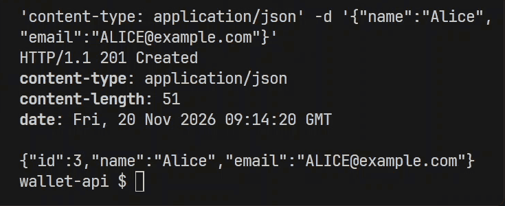

# Lesson 4: Validation in Rust with Newtypes and TryFrom

Lesson 3 ended with an API that still accepted an empty name, or an email without an `@`, and its duplicate email rule could be bypassed with capital letters (`alice@example.com` and `ALICE@example.com` became two users). This lesson applies "parse, don't validate": the request DTO is kept apart from the domain types, `UserName` and `Email` are newtypes with private fields, and `TryFrom` is the only way to build them. Once a value gets through, an invalid name or email can't exist anywhere in the program. Built with Rust (edition 2024), [Axum](https://github.com/tokio-rs/axum) 0.8.9, [Tokio](https://tokio.rs/) 1.54.1, [Serde](https://serde.rs/) 1.0.229, [thiserror](https://github.com/dtolnay/thiserror) 2.0.21 and [validator](https://github.com/Keats/validator) 0.21.0.



**Full video tutorial on YouTube (14 min):** https://youtu.be/o4VHyqKAC1U

---

## What it does

Same five routes as lesson 3. `POST /users` and `PUT /users/{id}` now validate the body before touching the data:

| Field | Rule | Stored as |
|---|---|---|
| `name` | not empty after trimming, at most 50 characters | trimmed (`"  Bob  "` → `"Bob"`) |
| `email` | a valid email address (checked by the `validator` crate) | trimmed and lowercased (`" Bob@Example.com "` → `"bob@example.com"`) |

A request with invalid data gets a `422 Unprocessable Entity` that lists **every** invalid field at once, not just the first one:

```json
{
  "code": "validation_failed",
  "message": "invalid request data",
  "fields": [
    {"field": "name", "message": "cannot be empty"},
    {"field": "email", "message": "must be a valid email"}
  ]
}
```

Every other error keeps the lesson 3 body (`code` + `message`); `fields` only appears on the `422`.

| Status | `code` | When |
|---|---|---|
| `422 Unprocessable Entity` | `validation_failed` | the JSON is well formed but `name` or `email` breaks a rule |
| `409 Conflict` | `email_taken` | another user already has that email. Emails are normalized first, so `BOB@EXAMPLE.COM` matches `bob@example.com` |
| `404 Not Found` | `user_not_found` | `GET`, `PUT` or `DELETE` on `/users/{id}` with an id that doesn't exist |
| `400 Bad Request` | `invalid_path` | the id in the path is not a number (`/users/abc`) |
| `400` / `415` / `422` | `invalid_json` | malformed JSON, missing `content-type: application/json`, or a missing field |
| `500 Internal Server Error` | `internal_error` | a poisoned lock |

## How it works: parse, don't validate

The client sends plain strings. They land in a DTO that has no rules at all:

```rust
#[derive(Deserialize)]
struct UserInput {
    name: String,
    email: String,
}
```

The domain types live in their own module, [`src/domain.rs`](src/domain.rs). Privacy in Rust works per module, so outside `domain` nobody can write `Email(...)` directly. The only constructor is `TryFrom`, and it either returns a checked value or an error:

```rust
#[derive(Clone, Debug, PartialEq, Serialize)]
pub struct Email(String);

impl TryFrom<String> for Email {
    type Error = String;

    fn try_from(value: String) -> Result<Self, Self::Error> {
        let email = value.trim().to_lowercase();
        if !email.validate_email() {
            return Err("must be a valid email".into());
        }
        Ok(Self(email))
    }
}
```

`UserName` follows the same pattern (trim, not empty, at most 50 characters). Both serialize as plain strings, so the JSON responses don't change.

`User` now stores the domain types instead of `String`:

```rust
#[derive(Clone, Serialize)]
struct User {
    id: u64,
    name: UserName,
    email: Email,
}
```

From here on, the compiler makes sure a `User` can only be built from values that went through the gate.

### One gate for the whole request

`TryFrom<UserInput> for NewUser` tries both fields, collects every error in a `Vec<FieldError>`, and returns `ApiError::Validation` if any field failed. Its `type Error` is `ApiError`, so `?` in the handler returns the `422` directly, with no extra `From` impl:

```rust
impl TryFrom<UserInput> for NewUser {
    type Error = ApiError;

    fn try_from(input: UserInput) -> Result<Self, Self::Error> {
        let mut errors = Vec::new();
        let name = UserName::try_from(input.name)
            .map_err(|message| errors.push(FieldError { field: "name", message }))
            .ok();
        let email = Email::try_from(input.email)
            .map_err(|message| errors.push(FieldError { field: "email", message }))
            .ok();
        match (name, email) {
            (Some(name), Some(email)) => Ok(NewUser { name, email }),
            _ => Err(ApiError::Validation(errors)),
        }
    }
}

async fn create_user(
    State(state): State<AppState>,
    AppJson(input): AppJson<UserInput>,
) -> Result<(StatusCode, Json<User>), ApiError> {
    let new_user = NewUser::try_from(input)?;
    // ...
}
```

The `fields` list is skipped in every other error body with `#[serde(skip_serializing_if = "Vec::is_empty")]`.

### Duplicate emails, fixed for free

The `409` check is the same line as in lesson 3: `user.email == new_user.email`. It works now because every `Email` is already trimmed and lowercased. The rule didn't change; the type made it correct.

## The compiler errors from the video

1. **`cannot initialize a tuple struct which contains private fields` (E0423).** Building `Email(String::from("not an email"))` in `main.rs` doesn't compile: the field is private to the `domain` module, so `TryFrom` is the only way in.
2. **`mismatched types`: expected `UserName`, found `String` (E0308).** After `User` switched to `UserName` and `Email`, the compiler pointed at every handler that still put unchecked strings into a user (`create_user` and `update_user`).
3. **`no method named to_lowercase found for struct UserName` (E0599).** The name filter in `list_users` needed `user.name.as_str()`.

## Trying it with curl

Start the server in one terminal:

```bash
cargo run
```

Then, in another terminal:

```bash
curl -i -X POST localhost:8080/users -H 'content-type: application/json' -d '{"name":"","email":"not-an-email"}'            # 422 validation_failed, both fields
curl -i -X POST localhost:8080/users -H 'content-type: application/json' -d '{"name":"  Bob  ","email":" Bob@Example.com "}'  # 201, saved as "Bob" / "bob@example.com"
curl -i -X POST localhost:8080/users -H 'content-type: application/json' -d '{"name":"Bob","email":"BOB@EXAMPLE.COM"}'        # 409 email_taken
```

## Project structure

```
04-validation/
├── Cargo.toml        # axum (with the "macros" feature), serde, thiserror, tokio, validator
├── Cargo.lock
├── docs/demo.gif
└── src/
    ├── domain.rs     # UserName and Email: newtypes with private fields, built only through TryFrom
    └── main.rs       # UserInput DTO, NewUser gate, shared state, ApiError (with Validation), extractors, router and handlers
```

## Running it

Requirements: Rust 1.85 or newer (edition 2024), plus `curl` to test.

```bash
git clone https://github.com/fernando1000/wallet-api.git
cd wallet-api/04-validation
cargo run
```

The API listens on `http://localhost:8080`.

Dependencies:

```toml
[dependencies]
axum = { version = "0.8.9", features = ["macros"] }
serde = { version = "1.0.229", features = ["derive"] }
thiserror = "2.0.21"
tokio = { version = "1.54.1", features = ["full"] }
validator = "0.21.0"
```

## Important note

This project is for learning. The data still lives in memory and is lost when the server stops. A real wallet API would keep it in a database.

---

Made by Fernando Santos · [YouTube tutorial](https://youtu.be/o4VHyqKAC1U) · [LinkedIn](https://www.linkedin.com/in/fernando-blockchain)
